# AutoLedger Live Database ER Diagram

Verified against the live `autoledger_db` database in PostgreSQL 18.6 on
2026-11-07. The diagram contains all 16 public base tables and all 14 declared
foreign keys. Column labels include the actual SQL type in the attribute
comment, and mark primary keys (`PK`), foreign keys (`FK`), unique columns
(`UK`), nullability, and generated identifiers where applicable.

```mermaid
erDiagram
    ROLES ||--o{ USERS : "role_id"
    USERS o|--o{ AUDIT_LOGS : "user_id (nullable)"
    USERS ||--o{ INSPECTIONS : "inspector_id"
    USERS ||--o{ VERIFICATION_RECORDS : "verified_by"
    VEHICLES ||--o{ OWNERSHIP_RECORDS : "vehicle_id"
    OWNERS ||--o{ OWNERSHIP_RECORDS : "owner_id"
    VEHICLES ||--o{ SERVICE_RECORDS : "vehicle_id"
    VEHICLES ||--o{ REPAIR_RECORDS : "vehicle_id"
    VEHICLES ||--o{ MILEAGE_RECORDS : "vehicle_id"
    VEHICLES ||--o{ INSPECTIONS : "vehicle_id"
    VEHICLES ||--o{ DOCUMENTS : "vehicle_id"
    VEHICLES ||--o{ VERIFICATION_RECORDS : "vehicle_id"
    SUPPLIERS o|--o{ PURCHASES : "supplier_id (nullable)"
    CUSTOMERS o|--o{ SALES : "customer_id (nullable)"

    ROLES {
        int role_id PK "integer, generated always"
        varchar role_name UK "character varying(50), not null"
        varchar description "character varying(255), nullable"
    }
    USERS {
        int user_id PK "integer, generated always"
        int role_id FK "integer, not null"
        varchar full_name "character varying(100), not null"
        varchar email UK "character varying(150), not null"
        varchar phone "character varying(30), nullable"
        boolean is_active "boolean, not null, default true"
        timestamp created_at "timestamp without time zone, not null, default CURRENT_TIMESTAMP"
        varchar password_hash "character varying(255), nullable"
    }
    AUDIT_LOGS {
        int audit_id PK "integer, generated always"
        int user_id FK "integer, nullable"
        varchar action "character varying(50), not null"
        varchar entity_name "character varying(100), not null"
        int entity_id "integer, nullable"
        timestamp action_timestamp "timestamp without time zone, not null, default CURRENT_TIMESTAMP"
        text details "text, nullable"
    }
    OWNERS {
        int owner_id PK "integer, generated always"
        varchar full_name "character varying(100), not null"
        varchar phone "character varying(30), nullable"
        varchar email "character varying(150), nullable"
        timestamp created_at "timestamp without time zone, not null, default CURRENT_TIMESTAMP"
    }
    VEHICLES {
        int vehicle_id PK "integer, generated always"
        varchar vin UK "character varying(17), not null"
        varchar registration_no UK "character varying(30), not null"
        varchar brand "character varying(50), not null"
        varchar model "character varying(50), not null"
        int model_year "integer, not null"
        varchar color "character varying(30), nullable"
        varchar fuel_type "character varying(20), nullable"
        varchar transmission "character varying(20), nullable"
        varchar engine_no UK "character varying(50), nullable"
        timestamp created_at "timestamp without time zone, not null, default CURRENT_TIMESTAMP"
    }
    OWNERSHIP_RECORDS {
        int ownership_id PK "integer, generated always"
        int vehicle_id FK "integer, not null"
        int owner_id FK "integer, not null"
        date start_date "date, not null"
        date end_date "date, nullable"
        varchar ownership_status "character varying(20), not null, default ACTIVE"
    }
    SERVICE_RECORDS {
        int service_id PK "integer, generated always"
        int vehicle_id FK "integer, not null"
        date service_date "date, not null"
        varchar service_type "character varying(100), not null"
        int mileage "integer, nullable"
        varchar workshop_name "character varying(150), nullable"
        text notes "text, nullable"
        numeric cost "numeric(12,2), nullable"
    }
    REPAIR_RECORDS {
        int repair_id PK "integer, generated always"
        int vehicle_id FK "integer, not null"
        date repair_date "date, not null"
        varchar repair_type "character varying(100), not null"
        text description "text, nullable"
        numeric cost "numeric(12,2), nullable"
        varchar workshop_name "character varying(150), nullable"
    }
    MILEAGE_RECORDS {
        int mileage_id PK "integer, generated always"
        int vehicle_id FK "integer, not null"
        date recorded_date "date, not null"
        int mileage "integer, not null"
        varchar source "character varying(30), not null"
    }
    INSPECTIONS {
        int inspection_id PK "integer, generated always"
        int vehicle_id FK "integer, not null"
        int inspector_id FK "integer, not null"
        date inspection_date "date, not null"
        varchar result "character varying(20), not null"
        text remarks "text, nullable"
    }
    DOCUMENTS {
        int document_id PK "integer, generated always"
        int vehicle_id FK "integer, not null"
        varchar document_type "character varying(50), not null"
        varchar document_number "character varying(100), nullable"
        date issue_date "date, nullable"
        date expiry_date "date, nullable"
        varchar status "character varying(20), not null, default VALID"
    }
    VERIFICATION_RECORDS {
        int verification_id PK "integer, generated always"
        int vehicle_id FK "integer, not null"
        int verified_by FK "integer, not null"
        date verification_date "date, not null"
        varchar result "character varying(20), not null"
        text remarks "text, nullable"
    }
    SUPPLIERS {
        int supplier_id PK "integer, sequence default"
        varchar supplier_name "character varying(150), not null"
        varchar phone "character varying(30), nullable"
        varchar email "character varying(150), nullable"
    }
    PURCHASES {
        int purchase_id PK "integer, sequence default"
        int supplier_id FK "integer, nullable"
        date purchase_date "date, not null"
        numeric total_amount "numeric(12,2), nullable"
    }
    CUSTOMERS {
        int customer_id PK "integer, sequence default"
        varchar customer_name "character varying(150), not null"
        varchar phone "character varying(30), nullable"
        varchar email "character varying(150), nullable"
    }
    SALES {
        int sale_id PK "integer, sequence default"
        int customer_id FK "integer, nullable"
        date sale_date "date, not null"
        numeric total_amount "numeric(12,2), nullable"
    }
```

## Relationship explanation

- **Roles and users:** each user has exactly one role; a role can be assigned to
  zero or many users.
- **Users and activity:** an inspection and verification each reference exactly
  one user. A user can perform many of either. Audit rows can have no user
  (`user_id` is nullable), for example when no actor is associated with a
  database change.
- **Vehicle history:** a vehicle can have zero or many dated ownership, service,
  repair, mileage, inspection, document, and verification records. Every such
  record references exactly one vehicle. Ownership records each reference one
  owner; an owner can have zero or many ownership records over time. A partial
  unique index limits a vehicle to at most one `ACTIVE` ownership row at once;
  its full ownership history remains one-to-many.
- **Purchasing:** a purchase may reference zero or one supplier because
  `supplier_id` is nullable; a supplier can be referenced by many purchases.
- **Sales:** a sale may reference zero or one customer because `customer_id` is
  nullable; a customer can be referenced by many sales.
- **No one-to-one relationship is declared.** The schema declares 14 foreign
  keys, all many-to-one from the referencing table to the referenced table.
  Their reverse cardinalities are one-to-many, with optional child rows as
  shown.
- **No purchase/sale-to-vehicle relationship exists in this schema.** Neither
  transaction table has a vehicle column, and there is no transaction line-item
  table connecting them to vehicles.

See [DATABASE_ARCHITECTURE.md](./DATABASE_ARCHITECTURE.md) for the full
constraints, indexes, views, triggers, and normalization observations.
