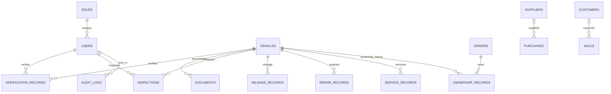
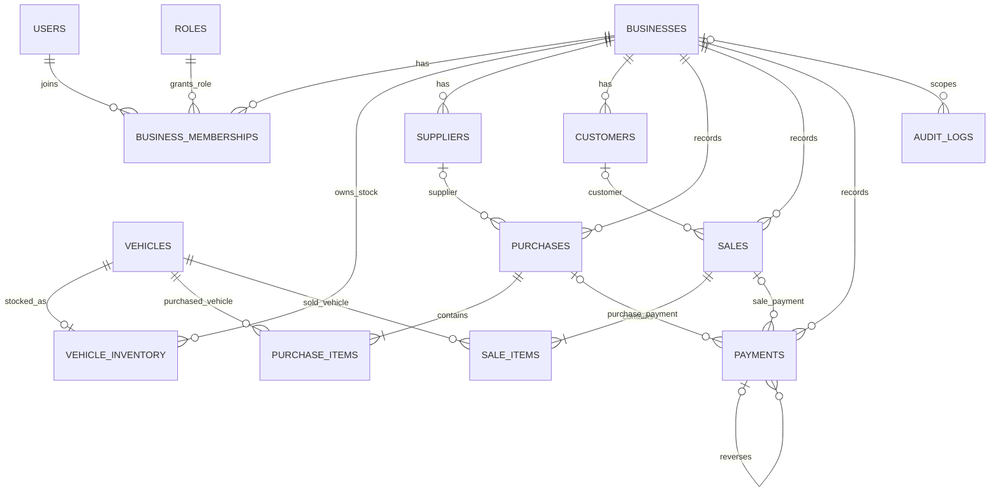

# AutoLedger Entity Relationship Diagrams

The diagrams intentionally separate the **live schema** from the **proposed,
unexecuted design**. A proposed relation shown below is not present in the
live database.

## Current live relationships

Catalog inspected read-only on 2026-11-09. Current purchase/sale headers do
not point to vehicles; no purchase items, sale items, inventory, payments, or
businesses are installed.

The four live views are `vw_vehicle_summary`, `vw_owner_history`,
`vw_expiring_documents`, and `vw_monthly_costs`. See
[ER_DIAGRAM.md](./ER_DIAGRAM.md) for the existing detailed diagram.

## Proposed future relationships — not live

The following captures the intended additive model in the Phase 4/7 drafts.
Tenant fields remain nullable so existing business rows can stay unassigned.
Application membership validation, per-query tenant filtering, and
tenant-aware triggers are required in addition to these FKs.

`VEHICLE_INVENTORY` is proposed as one current stock row per vehicle, so the
model assumes a vehicle is stocked by at most one business at a time.
Concurrent sale prevention is based on locking and stock lifecycle checks,
not on a permanent unique `sale_items.vehicle_id` constraint, because later
resale must remain possible.

The current SQL draft should be independently reviewed for cross-tenant
consistency, especially purchase item and inventory onboarding order,
business-to-business vehicle transfer handling, and audit attribution. Do not
execute this diagram or the associated SQL against the live database.
